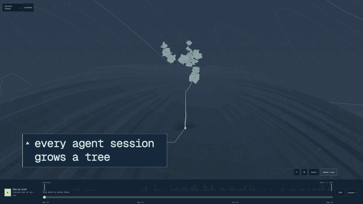

# Agent Garden

Your Codex and Claude Code sessions, grown into a garden.

[](https://github.com/ashkanrdn/agent-garden/actions/workflows/test.yml)

[](https://ashkanrdn.github.io/agent-garden/media/agent-garden-demo.mp4)

[**Open Agent Garden**](https://ashkanrdn.github.io/agent-garden/) · [**Try the demo garden**](https://ashkanrdn.github.io/agent-garden/?demo) · [**Watch the full video (55 s)**](https://ashkanrdn.github.io/agent-garden/media/agent-garden-demo.mp4)

Agent Garden turns your local coding sessions into an island of project plots, trees, and birds. It is a visual toy, not a productivity metric. Your data stays on your machine and in your browser.

## Grow your garden

1. Run the exporter in the directory where you want to save your garden:

   ```sh
   curl -fsSL https://ashkanrdn.github.io/agent-garden/agent_garden_export.py | python3 -
   ```

   It writes `agent-garden.json` in that directory.

2. [Open Agent Garden](https://ashkanrdn.github.io/agent-garden/) and drop `agent-garden.json` onto the page. You can also choose it with the file picker.

Prefer to read it first? Download the script, inspect it in your editor, then run it:

```sh
curl -fsSLo agent_garden_export.py https://ashkanrdn.github.io/agent-garden/agent_garden_export.py
python3 agent_garden_export.py
```

The exporter requires Python 3.9+ and uses only the standard library. Git is optional; it supplies local commit history. Tested on macOS and Linux; Windows is untested.

A run ends with one line per source, then totals. These numbers are made up:

```text
codex-live (live): 24 sessions, 3 projects, 18 commits; 24 files, 1200 records, 0 malformed, 0 errors
claude-code (claude-code): 12 sessions, 2 projects, 9 commits; 12 files, 800 records, 0 malformed, 0 errors
Exported 36 sessions, 4 projects, 21 commits.
Output: /path/to/agent-garden.json (85,420 bytes)
```

Sources can share projects and commits, so their counts do not always add up to the totals.

## What you're looking at

| In the garden | What it means |
| --- | --- |
| Project plots | Each repository or recorded workspace becomes a plot on the island. Branches and worktrees share their repository's plot. |
| Session trees | Each primary session becomes a tree, including its delegated work. Species reflects the recorded session pattern. Size ranks recorded work; canopy density ranks distinct changed files. |
| Birds | Subagents fly around their session tree. |
| Fruit | Commits appear as project fruit when session ownership is unknown. Crown fruit counts recorded file additions, capped at five. |
| Arrival weather | Clouds, rain, and lightning decorate a tree's arrival. They do not measure activity. |
| Changed files | Click a tree to inspect its changed files. Tile area follows measured bytes; color shows file type; glow shows activity. |
| Timeline | Brush a date range, then replay a day within the recorded history. |

Species distinguish quick, conversation, build, orchestration, and slow-burn sessions. Tree growth reflects recorded work volume, not elapsed age or work quality. Files with zero or unknown sizes remain available in the file selector.

## Privacy

- The export includes counts, timestamps, project names, paths, short session titles, file events, current sizes, and local Git commits.
- It excludes full messages, full prompts, tool arguments, tool output, and file contents. A title can contain a short prompt excerpt.
- The exporter sends nothing to a server. The hosted page reads your file in browser memory and never uploads it.
- The hosted site has no accounts, upload endpoint, or upload analytics. It does not save exports in browser storage.
- Use `--redact` before sharing an export. It replaces private labels and paths but keeps timing, sizes, and relationships. Review the result before sharing; see [privacy details](docs/privacy.md).

## Exporter options

| Option | Use |
| --- | --- |
| `--source {all,codex,claude-code}` | Select history. Default: `all`. |
| `--codex-home PATH` | Set the Codex directory. Default: `CODEX_HOME` or `~/.codex`. |
| `--claude-home PATH` | Set the Claude directory. Default: `CLAUDE_CONFIG_DIR` or `~/.claude`. |
| `--backup-root PATH` | Include an optional Codex backup. No backup is read by default. |
| `--output PATH` | Set the output file. Default: `./agent-garden.json`. |
| `--no-git` | Skip Git inspection and commit history. Keep workspace projects and current file sizes. |
| `--redact` | Replace names, paths, branches, and linked identifiers; remove titles. Preserve counts, timestamps, extensions, sizes, and relationships. |
| `-h, --help` | Show help and exit. |

```sh
python3 agent_garden_export.py --help
```

## Sources and limits

**Codex:** reads local history from `CODEX_HOME` or `~/.codex`. An optional `--backup-root` adds saved history; the exporter reconciles duplicate evidence.

**Claude Code:** reads JSONL transcripts under `CLAUDE_CONFIG_DIR/projects` or `~/.claude/projects`, including subagent transcripts. Claude Code's `cleanupPeriodDays` setting defaults to 30 days. Deleted transcripts cannot contribute older sessions. See the [Claude Code transcript documentation](https://code.claude.com/docs/en/sub-agents#resume-subagents).

File changes come from supported successful edit tools. Shell writes and incomplete records can leave gaps. File sizes describe files at export time, not historical sizes. Git inspection uses available local history and never fetches remotes. The exporter cannot prove which session owns a commit.

Missing sources, parser errors, and unresolved subagent links appear as coverage gaps. See the [data format](docs/data-format.md) for fields and evidence limits.

## Run it locally (Live Mode)

From a clone or downloaded copy of this repository, run:

```sh
python3 local/start_garden.py
```

The launcher starts a local server and opens the garden. Use **Refresh local data** to import current records. **Live Mode** follows current Codex sessions and delegated agents. Claude Code appears in exports but is not a Live Mode source.

## Development

No npm package installation is needed for the tests. Use Node.js 22 and Python 3.9+.

| Path | Contents |
| --- | --- |
| [agent_garden_export.py](agent_garden_export.py) | Standalone exporter. |
| `web/` | Static garden, bundled dependencies, media, and synthetic demo data. |
| `local/` | Local server, launcher, and Live Mode. |
| `tests/web/`, `tests/python/`, `tests/fixtures/` | Tests and synthetic inputs. |
| [tools/make_demo_data.py](tools/make_demo_data.py) | Deterministic demo generator. |

Run both suites from the repository root:

```sh
npm test
python3 -m unittest discover -s tests/python
```

Regenerate [the synthetic demo](web/demo/agent-garden-demo.json):

```sh
python3 tools/make_demo_data.py
```

[Test CI](.github/workflows/test.yml) checks Node.js 20/22 and Python 3.9/3.12, exporter help, and a synthetic smoke export. [Pages deployment](.github/workflows/pages.yml) runs both suites before publishing `web/` and the exporter. It runs on pushes to `main` or a manual workflow dispatch.

See [CONTRIBUTING.md](CONTRIBUTING.md) for contribution steps.

## License and credits

Agent Garden uses the [MIT license](LICENSE). Bundled p5.brush has its own [license](web/vendor/p5-brush-2.2.2/LICENSE.md). Its [dependency notices](web/vendor/p5-brush-2.2.2/THIRD-PARTY-NOTICES.md) cover simplex-noise and spectral.js. The procedural film code has a separate [license notice](web/third-party/procedural-film-LICENSE.txt).
